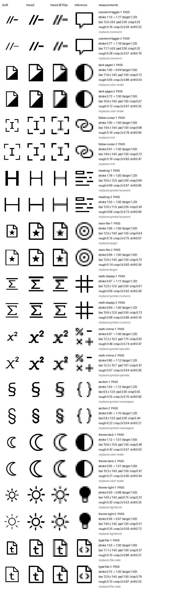

# Glyphy

Make icon glyphs that match an existing icon style, and prove they match.

Glyphy measures a reference icon set (stroke width, live area, padding, pixel
crispness, letterform rules), writes a brief an image model can follow, then
turns the model's black-on-white drafts into clean SVGs: it extracts the ink,
fits it to the grid, corrects the stroke to the measured width, traces it,
snaps it to pixels and measures the result with the same code it used on the
references. Every glyph gets a pass/fail report and a contact sheet beside the
icons it lives with.



It is built for AI agents (one command per step, `glyphy status` says what is
next, skills for GPT-6 and Claude 5.5 models) without taking control away from
people: every rule and knob is in one file and can be pinned, overridden per
glyph, overridden for one run, or driven from Python.

## Install

```sh
uvx --from git+https://github.com/MRoiban/glyphy glyphy --help      # run without installing
uv tool install git+https://github.com/MRoiban/glyphy                # or install the `glyphy` command
pip install git+https://github.com/MRoiban/glyphy                    # or into any environment
```

Python ≥ 3.11 and the Cairo library (present on most Linux/macOS systems;
`brew install cairo` or `apt install libcairo2` otherwise).

## Quick start

```sh
glyphy init -p my-icons -r path/to/reference-icons/   # copy references, measure the style
glyphy add -p my-icons moon "a crescent moon"
glyphy add -p my-icons heading 'a capital "H"' --kind letter
glyphy brief -p my-icons                               # → my-icons/out/brief.md
# Generate drafts from the brief with an image model; save them as
#   my-icons/generated/<name>-<n>.png   (black ink on white)
glyphy trace -p my-icons                               # vectorise, correct, measure
glyphy sheet -p my-icons                               # → my-icons/out/sheet.png
glyphy pick  -p my-icons --best                        # or: glyphy pick moon=2 heading=1
glyphy export -p my-icons -f ts -o src/glyphs.ts       # or -f json / -f sprite
glyphy status -p my-icons                              # where am I, what's next
```

Drafts can also be SVGs (for example drawn by hand or by a model that writes
SVG): put `<name>-<n>.svg` in `generated/` and they go through the same steps.
`glyphy check file.svg` measures any finished SVG against the style.

## How it works

1. **Measure the references** (`glyphy measure`). Each reference is rendered at
   32 px per grid unit. Stroke width is twice the median distance from the
   skeleton to the edge (corner and junction outliers removed); the ink box,
   padding, coverage and crispness (share of inked pixels that are solid at the
   native size) are recorded. Medians become the rules; `out/baseline.json`
   keeps every number. On Codicons this finds a 1.0-unit stroke, a 14×14 live
   area, 1-unit padding and 0.6 crispness.
2. **Brief** (`glyphy brief`). The rules converted to pixels at the image size,
   the output format (pure black on pure white, one glyph per image, file
   names) and the glyph list. Pass `out/reference-sheet.png` to the image
   model as a style reference when it accepts images.
3. **Trace** (`glyphy trace`). Ink extraction; fit into the live area (or the
   letter height); stroke correction by erosion/dilation, iterated with
   refitting until both hold; potrace; snapping of straight corners to whole
   pixels; a search over sub-pixel offsets that keeps the crispest passing,
   best-centred result; then re-measurement. Letterforms keep their own weight
   inside the measured letter range.
4. **Review** (`glyphy sheet`). Draft, traced glyph large and at native size,
   the reference icon it replaces, and its numbers. Numbers say whether a glyph
   obeys the rules; the sheet says whether it reads well. Use both.

## Configuration

Everything lives in `glyphy.toml`:

| Section | What it holds |
|---|---|
| `[style]` | The rules. `grid` (units per side) is yours; `stroke`, `letter_stroke`, `live`, `letter_height`, `pad_min`, `centring_max`, `crisp_reference` are written by `glyphy measure` unless listed in `locked`. `stroke_tolerance` is yours. |
| `[trace]` | Vectorisation knobs: `work_scale`, `threshold`, `speck`, `fit`, `correct`, `rounds`, `stroke_epsilon`, `snap`, `offsets`, `centring_weight`, potrace's `turdsize`, `alphamax`, `opticurve`, `opttolerance`, and `decimals`. |
| `[brief]` | `variants`, `image_size`, `notes`, and `template` (your own brief). |
| `[paths]` | Folder names for references, drafts, traced files, picks and reports. |
| `[glyphs.<name>]` | `concept`, `kind` (`icon`/`letter`), `replaces`, plus any `[style]`/`[trace]` key for this glyph alone, and `box = [w, h]` or `stroke_target`. |
| `[picks]` | The chosen variant per glyph. |

## Control for power users

The defaults are a starting point, never a cage:

```sh
glyphy set style.stroke=1.5 --lock            # pin a rule; `measure` will keep it
glyphy set trace.alphamax=1.1 trace.snap=0    # change any knob (TOML values)
glyphy set glyphs.moon.correct=false          # leave one glyph's stroke as drawn
glyphy set glyphs.heading.stroke_target=1.0   # force a stroke for one glyph
glyphy trace --only moon --set trace.offsets=8 style.live=13   # one run, not saved
glyphy config --glyph moon                    # the exact settings tracing will use
glyphy set brief.template=my-brief.md         # your own brief, with {placeholders}
```

Template placeholders: `grid`, `image_size`, `unit_px`, `variants`,
`reference_sheet`, `generated_dir`, `stroke`, `stroke_px`, `letter_stroke_min`,
`letter_stroke_max`, `live`, `live_px`, `letter_height`, `pad_min`, `pad_px`,
`notes`, `glyph_list`, `default_brief`.

From Python, every step is a function:

```python
from pathlib import Path
from glyphy import load, measure_references, trace_file, check_svg
from glyphy.trace import ink_mask, normalise, to_svg

project = load("my-icons")
project.style["live"] = 13                     # edit anything in memory
measure_references(project)
svg, report = trace_file(project, Path("my-icons/generated/moon-1.png"), {"alphamax": 1.1})

cfg = project.settings("moon")                 # or build your own pipeline from the parts
mask, raw_stroke, target = normalise(ink_mask(Path("draft.png"), cfg, project.grid), cfg, project.grid)
print(check_svg(project, to_svg(mask, cfg, project.grid)))
```

## Agents

- `skills/glyphy-gpt/` — for GPT-6 family models (Codex), which can generate images.
- `skills/glyphy-claude/` — for Claude 5.5 family models, which cannot generate
  images and either delegate generation or draft SVG on the grid.

Install a skill by copying its folder into the agent's skills directory
(`~/.codex/skills/` or `~/.claude/skills/`). `AGENTS.md` describes the repository
for agents working on Glyphy itself.

## Example

`examples/codicon-style/` is a complete project: 30 Codicons as references,
11 new glyphs (heading, maths, comment, follow cursor, section, sun, moon, dark
pages, main file, Typst file) drafted with GPT-6.1 Terra's image generation,
traced, picked and exported. They ship in the Typewriter editor.

## Licence

MIT. The Codicons in `examples/codicon-style/reference` are © Microsoft, CC BY 4.0
(see `examples/codicon-style/NOTICE`).
